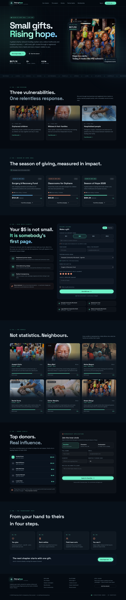
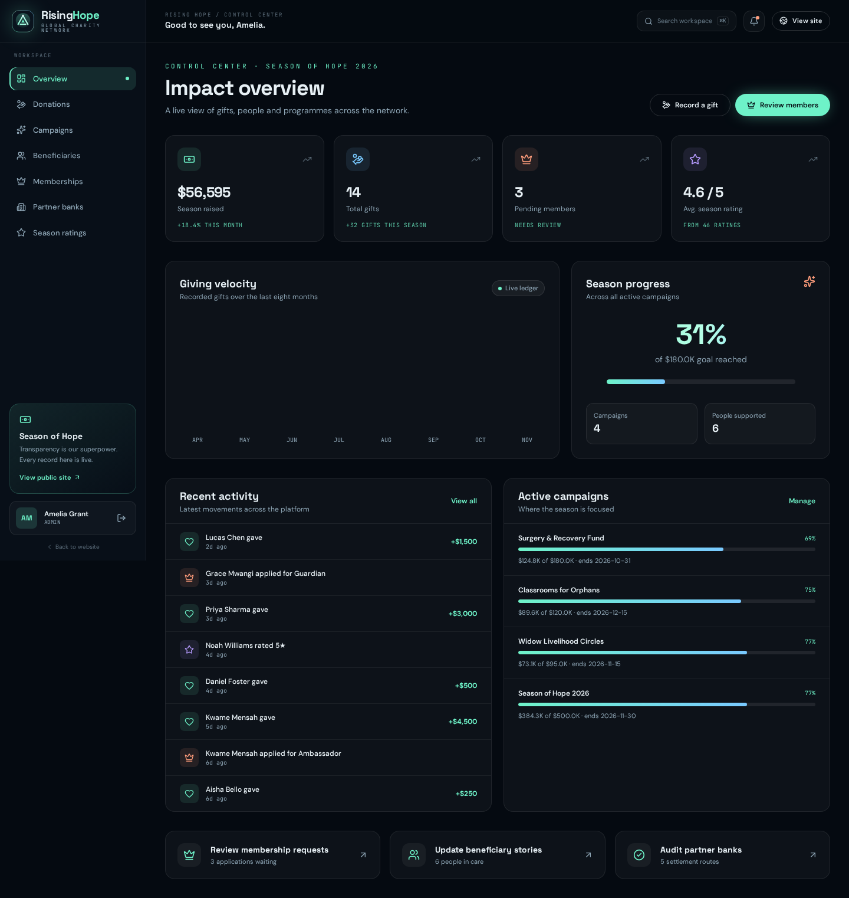
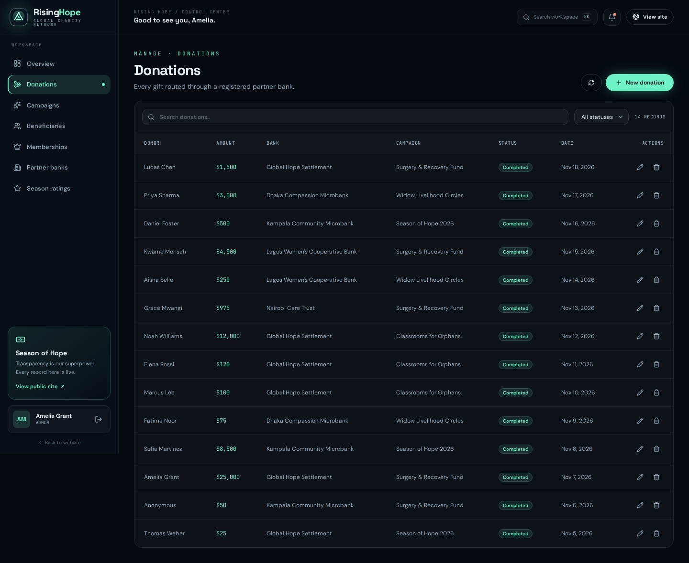

# Rising Hope

A full-stack, open charity platform for orphans, widows and hospitalised people. Built with Next.js 16 (App Router), React 19, Tailwind CSS 4, Drizzle ORM and PostgreSQL.

> **Live demo:** https://3000-ibkjbwyglwjt7ygc945co.e2b.app  
> Preview links may rotate after a redeploy. Sign in with `admin@risinghope.org` / `hope2026` to explore the dashboard.

## Screenshots

**Public homepage — campaigns, giving flow and impact stories**



**Dashboard — live impact analytics and season progress**



**Donations management — searchable CRUD ledger with optimistic updates**



## Features

- Public impact site with seasonal campaigns, beneficiary stories, partner micro-banks and a donor leaderboard.
- Micro-donations from $1 with bank routing, campaign allocation, donor ratings and seasonal progress tracking.
- Email verification with hashed one-time tokens, expiring links, resend support and one-click verification.
- Membership applications for top donors with Guardian / Champion / Ambassador tiers and admin review.
- Email/password authentication with scrypt hashing and database-backed sessions.
- Dashboard with sidebar navigation, analytics, and full CRUD for donations, campaigns, beneficiaries, applications, banks and ratings.
- Optimistic updates, rollback on failure, search, filters, modal forms, empty states and responsive layouts.
- Automatic demo data seeding on first request.

## Quick start

```bash
npm install
cp .env.example .env
npx drizzle-kit push
npm run dev
```

Open `http://localhost:3000`.

### Demo accounts

| Email | Password | Role |
| --- | --- | --- |
| admin@risinghope.org | hope2026 | Admin (verified) |
| noah@example.com | hope2026 | Donor (verified) |

## Email verification

Set `RESEND_API_KEY` and `EMAIL_FROM` in `.env` to deliver real verification emails through Resend. Set `NEXT_PUBLIC_APP_URL` to the public site origin so links point to the right host.

Without an email provider, the app runs in demo mode: verification messages are written to the `email_outbox` table and the verification link is returned to the browser after registration or on resend. Dashboard access requires a verified email in both modes.

## Repository

The project is published at **https://github.com/Sam-Hub-stack/rising-hope** on the `main` branch.

To push future changes:

```bash
git add -A
git commit -m "Describe your change"
git push origin main
```

Use a personal access token or SSH authentication when prompted. `.env` is gitignored; use `.env.example` as the template. Revoke any token that has been shared in chat.
